<div align="center">

# Brickwise

### Discover builds that match you.

**Visual product discovery that learns your taste from simple Like / Pass decisions.**

[Repository](https://github.com/chamodiHsenevirathna/brickwise) · [Run the demo locally](#demo-and-setup) · [How it works](#how-it-works) · [Evaluation and limitations](#evaluation-and-limitations)

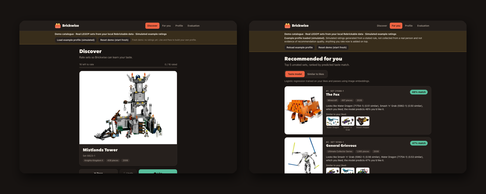

<sub>Real screenshots of the running app on a 16-set catalogue. The example profile behind them is **simulated**, not a real person.</sub>

</div>

> **Status:** working local MVP built on a catalogue of 800 real LEGO® sets. It runs entirely on your machine with free tools (no paid APIs, no accounts, no cloud). There is **no hosted live demo yet**. Recommendations have **not** been validated with real customers; see [Evaluation and limitations](#evaluation-and-limitations).

---

## The problem

Large catalogues have thousands of items, and most people want a handful.

- **Browsing doesn't scale.** Nobody scrolls through 800 pages of results, let alone 80,000.
- **Filters need the right vocabulary.** Categories and facets assume shoppers already know what they want, in the catalogue's own words. Taste is often visual and hard to say out loud ("like that one, but less busy").
- **Keyword search matches text, not looks.** Titles and descriptions say little about colour, shape and overall feel.
- **"Popular" serves the average shopper**, not this one.

## The solution

Brickwise turns discovery into a quick feedback loop. Showing a product and asking "yes or no?" is faster, and more honest, than asking someone to describe their taste.

1. You see **one product at a time** and tap **Like** or **Pass** (or press a key, or swipe).
2. Every product image has been converted into an **embedding** that captures its visual character.
3. After a few ratings, a small **classifier learns which visual traits go with your likes and your passes**.
4. It scores everything you haven't rated, and the **top picks come back with a plain-English reason** and the liked sets they resemble.

The model retrains from scratch on every request, so new feedback shows up immediately.

## How it works

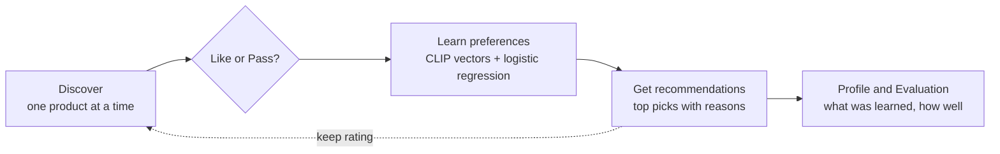

| Step | What happens |
|---|---|
| **1. Discover** | A card shows a real product photo with its name, set number, theme, piece count and year. |
| **2. Like / Pass** | Ratings are stored instantly in SQLite. One rating per product; **Undo** removes the latest. |
| **3. Learn** | With at least **3 likes and 3 passes** the model trains. Below that the app says so instead of guessing. |
| **4. Recommend** | Unrated products are ranked by predicted like-probability. Rated products are never returned. |
| **5. Explain and measure** | Each pick shows the liked sets it resembles. The Evaluation page compares the model to baselines on held-out ratings. |

## Product experience

All four screenshots are the real app, captured from the running local demo on a **16-set sample of the real catalogue** (photos, names, set numbers and themes are from the catalogue). The profile behind them is a **simulated example profile** (a made-up fan of City, Technic, Space, Racers, Star Wars and Ninjago sets), clearly labelled in the app. It is not a real person.

### Discover

One large card per product, with Like and Pass buttons, Undo, keyboard shortcuts (`→`/`L` like, `←`/`P` pass, `Z` undo), drag-to-swipe and a progress bar. Ratings survive restarts.

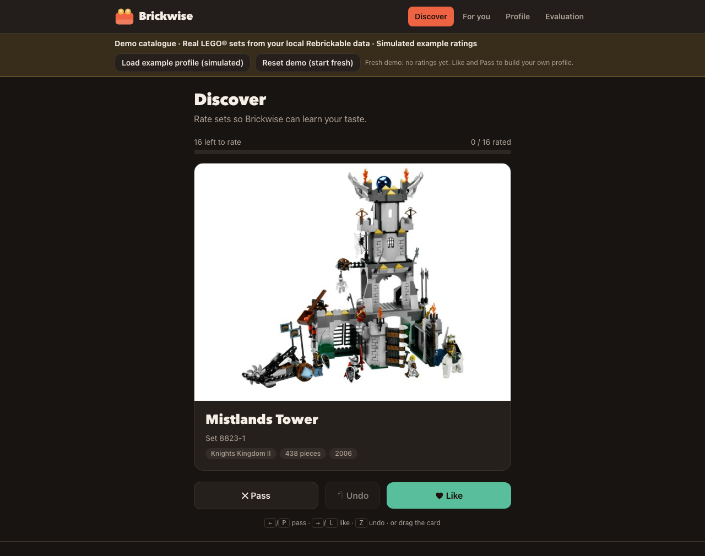

<sub>A fresh demo with no ratings yet. The banner always says which catalogue you are in and that example ratings are simulated.</sub>

### Recommendations

The top unrated sets, ranked by predicted match, each with a reason and the liked sets it resembles. A toggle switches between the learned taste model and a plain similarity baseline.

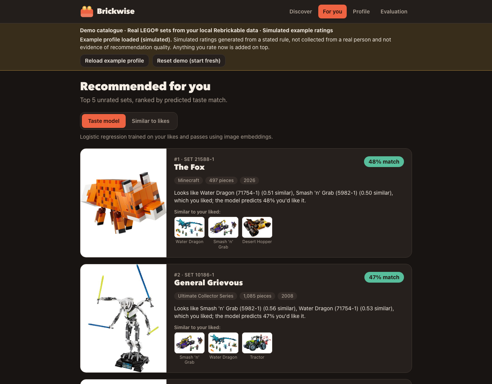

<sub>After loading the simulated profile (12 ratings). The top match is only about 48%: with so little data the model is not confident, and the app shows its number rather than inflating it.</sub>

### Profile

A readable summary of what the system has learned: like and pass counts, average piece count of liked versus passed sets, and per-theme like rates.

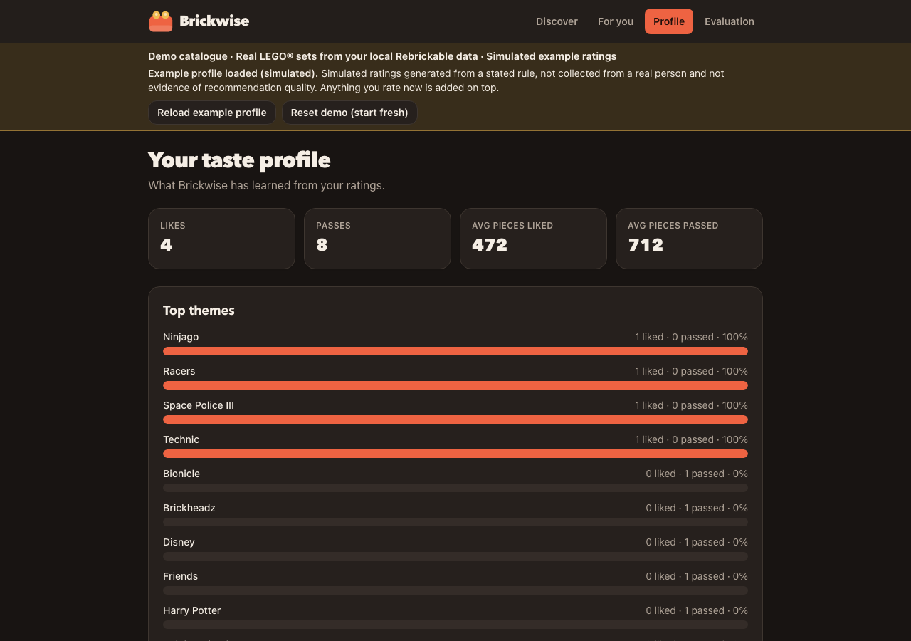

<sub>The simulated profile: 4 likes and 8 passes after 4 sets were held out so there are still sets to recommend.</sub>

### Evaluation

Precision@5 for the taste model, the similarity baseline and a random baseline, on held-out ratings. The app badges a report that includes simulated ratings, and keeps simulated-user runs separate.

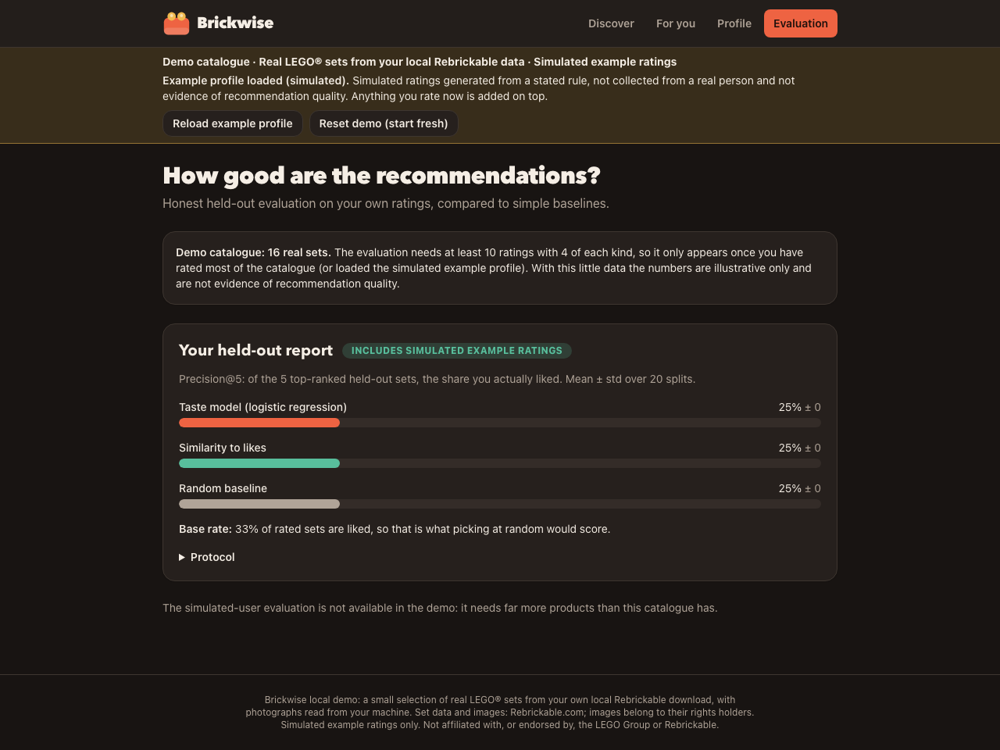

<sub>On 16 sets all three methods tie at 25%. That shows the pipeline running, not that one method wins. See [Evaluation and limitations](#evaluation-and-limitations).</sub>

### The sample catalogue

The 16 sets in the demo, one per theme, as they appear in the app (names, set numbers and themes are real catalogue records):

<table>
  <tr>
    <td align="center" valign="top" width="25%">
      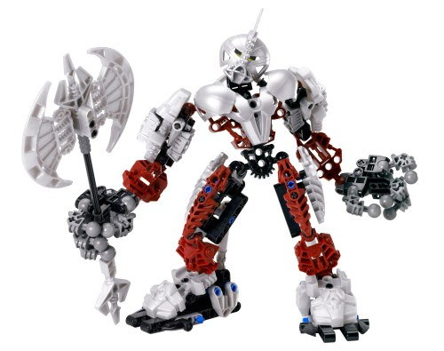<br>
      <sub><b>Axonn</b><br>8733-1 · Bionicle</sub>
    </td>
    <td align="center" valign="top" width="25%">
      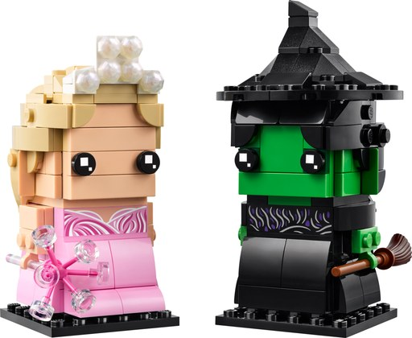<br>
      <sub><b>Elphaba &amp; Glinda Figures</b><br>40794-1 · Brickheadz</sub>
    </td>
    <td align="center" valign="top" width="25%">
      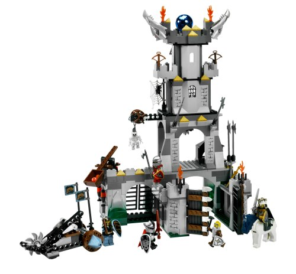<br>
      <sub><b>Mistlands Tower</b><br>8823-1 · Castle</sub>
    </td>
    <td align="center" valign="top" width="25%">
      <br>
      <sub><b>Air Ambulance</b><br>2064-1 · City</sub>
    </td>
  </tr>
  <tr>
    <td align="center" valign="top" width="25%">
      <br>
      <sub><b>Tropical Ukulele</b><br>31156-1 · Creator</sub>
    </td>
    <td align="center" valign="top" width="25%">
      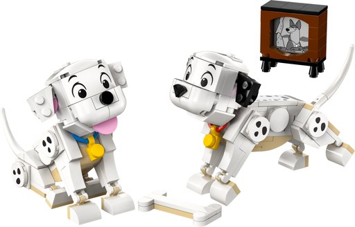<br>
      <sub><b>Lucky &amp; Penny 101 Dalmatians Puppies</b><br>43271-1 · Disney</sub>
    </td>
    <td align="center" valign="top" width="25%">
      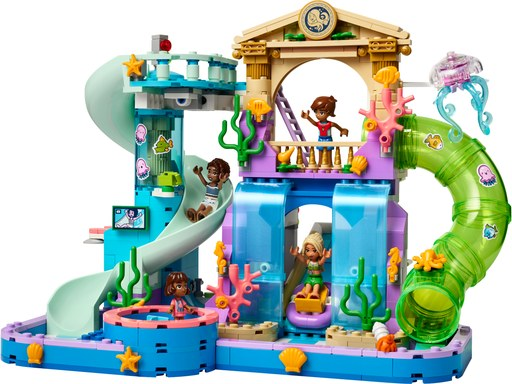<br>
      <sub><b>Heartlake City Water Park</b><br>42630-1 · Friends</sub>
    </td>
    <td align="center" valign="top" width="25%">
      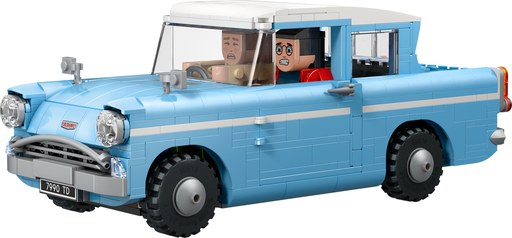<br>
      <sub><b>Enchanted Flying Ford Anglia</b><br>76470-1 · Harry Potter</sub>
    </td>
  </tr>
  <tr>
    <td align="center" valign="top" width="25%">
      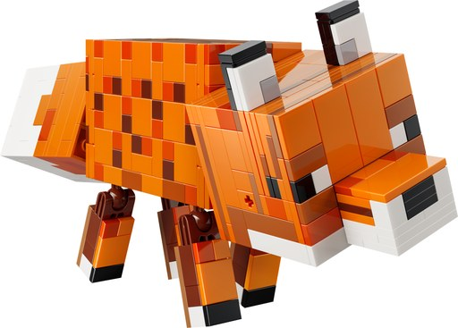<br>
      <sub><b>The Fox</b><br>21588-1 · Minecraft</sub>
    </td>
    <td align="center" valign="top" width="25%">
      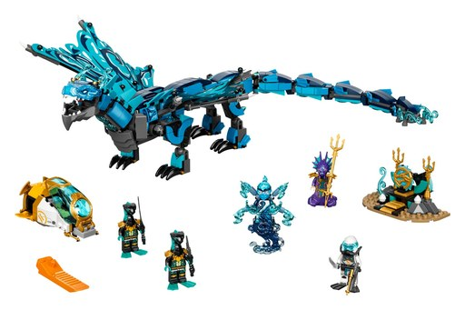<br>
      <sub><b>Water Dragon</b><br>71754-1 · Ninjago</sub>
    </td>
    <td align="center" valign="top" width="25%">
      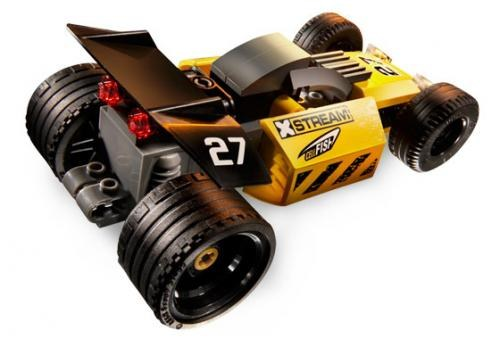<br>
      <sub><b>Desert Hopper</b><br>8490-1 · Racers</sub>
    </td>
    <td align="center" valign="top" width="25%">
      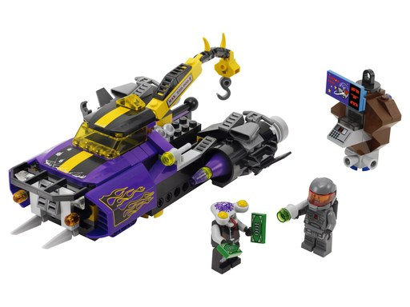<br>
      <sub><b>Smash &#x27;n&#x27; Grab</b><br>5982-1 · Space</sub>
    </td>
  </tr>
  <tr>
    <td align="center" valign="top" width="25%">
      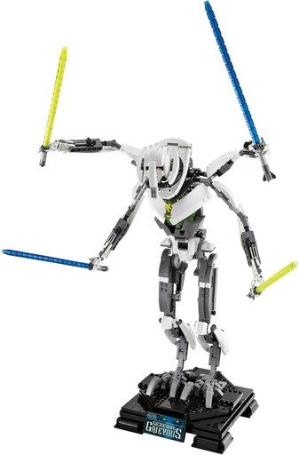<br>
      <sub><b>General Grievous</b><br>10186-1 · Star Wars</sub>
    </td>
    <td align="center" valign="top" width="25%">
      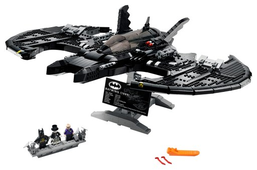<br>
      <sub><b>1989 Batwing</b><br>76161-1 · Super Heroes DC</sub>
    </td>
    <td align="center" valign="top" width="25%">
      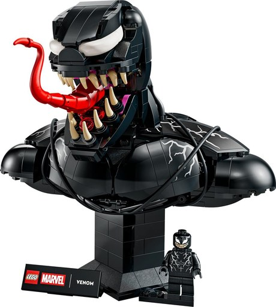<br>
      <sub><b>Venom Bust</b><br>76356-1 · Super Heroes Marvel</sub>
    </td>
    <td align="center" valign="top" width="25%">
      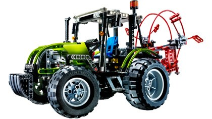<br>
      <sub><b>Tractor</b><br>8284-1 · Technic</sub>
    </td>
  </tr>
</table>

<sub>Photographs: Rebrickable.com. LEGO® sets and images belong to the LEGO Group and their respective rights holders. They are shown to illustrate the product. **Attribution is not permission:** see [Data, licensing and attribution](#data-licensing-and-attribution).</sub>

## AI and recommendation approach

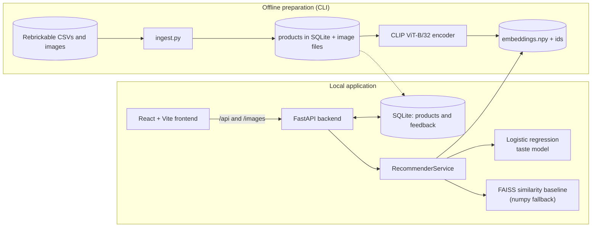

- **CLIP image embeddings.** Each image becomes a 512-dimensional unit vector (open_clip ViT-B/32, used as-is, no fine-tuning). Similar-looking products end up close together, so "visually similar" becomes a distance.
- **Logistic regression (the taste model).** Trained on *your* likes and passes with the CLIP vectors as features (class-balanced, `C=1`). It outputs the probability you would like an unseen set. It is small, needs few examples and retrains in milliseconds.
- **FAISS similarity (the baseline).** An exact inner-product index (`IndexFlatIP`, cosine on unit vectors) scores each unrated set by its mean similarity to its three nearest liked sets. If FAISS can't be imported, a numpy implementation is used.
- **How the signals are used.** Likes and passes are both training signal. The baseline only uses likes; the classifier also learns that a visual trait can be a reason to *reject* something. Whether that extra signal helps is measured, not assumed.
- **Guard rails.** Fewer than 3 likes or 3 passes returns `insufficient_feedback`. Rated products are never recommended. The ML code never touches the database: the API passes it a `{set_num: rating}` map ([API contract](docs/CONTRACTS.md)).

## Evaluation and limitations

**What the app measures.** *Precision@5*: of the five top-ranked held-out sets, the share you actually liked. The real report needs at least 10 ratings with 4 likes and 4 passes, and uses 20 repeated stratified 70/30 hold-outs. A *simulated* mode runs the same procedure on synthetic users whose likes are 1 to 3 random themes (with 10% label noise); it is always labelled `simulated`.

### Synthetic experiments (simulated users, not real people)

Run on the 800-set catalogue with the real CLIP embeddings: 5 synthetic users × 20 splits, mean Precision@5 (std across splits in brackets). Re-run for this README.

| Seed | Taste model (logreg) | Similarity (FAISS) | Random | Base rate |
|---|---|---|---|---|
| 0 | 0.42 (0.23) | 0.35 (0.19) | 0.22 (0.18) | 0.23 |
| 1 | 0.50 (0.18) | 0.40 (0.19) | 0.21 (0.15) | 0.22 |
| 2 | 0.42 (0.23) | 0.39 (0.19) | 0.23 (0.20) | 0.24 |

These say the pipeline learns something beyond chance on a **synthetic** task. They do **not** say how well it serves a real shopper: the synthetic "taste" is a product theme, only a loose proxy for what CLIP sees, and the variance across splits is large.

### What has not been done

- **No real-user validation.** No real people have rated sets and no recommendations have been tested with customers. Nothing here claims commercial readiness.
- **The demo numbers are illustrative.** The screenshots use a *simulated* 12-rating profile on 16 sets; scores sit near 50% and the methods tie.

### Current limitations

- Catalogue of 800 sets from 18 themes, not the full LEGO range.
- One local profile; no authentication or multi-user support.
- CLIP is general-purpose and its model card describes it as a research output (see [NOTICE.md](NOTICE.md)). It captures overall look (colour, shape, vehicle versus figure), not build complexity or minifigure content.
- The model retrains on every request: instant at 800 items, would need caching at scale.
- The UI was checked in desktop Chrome and jsdom tests only. Mobile layout and dark mode were not manually verified.
- The first embedding run needs internet access to download CLIP weights.
- Recommendation lists can be visually repetitive; there is no diversity step.

## Technology stack

| Layer | Technology |
|---|---|
| Frontend | React 18, TypeScript 5.6, Vite 5, Tailwind CSS 3, react-router |
| Backend | Python 3.12, FastAPI, Pydantic, SQLite (stdlib `sqlite3`), Uvicorn |
| ML | open_clip (CLIP ViT-B/32), PyTorch, scikit-learn (LogisticRegression), FAISS (CPU), NumPy, Pillow |
| Data | Rebrickable public `sets` / `themes` CSVs and set images |
| Testing | pytest + FastAPI TestClient (95 tests), Vitest + Testing Library + jsdom (27 tests), `tsc --noEmit` |

## Demo and setup

**There is no hosted demo.** Brickwise runs on your machine. It has two catalogues:

| | Real-catalogue demo (what the screenshots show) | Fictional demo (public fallback) |
|---|---|---|
| Products | 16 real sets from **your own** local Rebrickable catalogue | 12 fictional products, `BW-001` to `BW-012`, in this repo |
| Images | Your local `data/images/` photos, served read-only by the demo API | Original illustrations drawn by `backend/brickwise/data/demo_artwork.py` |
| Needs | The local catalogue and embeddings (steps 1 and 2 below) | Nothing but a clone |
| Example ratings | Simulated, from a stated rule | Synthetic |

The real-catalogue demo is **local only**: the catalogue is not distributed with the repository, so you build it yourself. The fictional demo is what anyone can run straight from a clone:

<details>
<summary>The fictional fallback catalogue (original artwork, fictional products)</summary>

<table>
  <tr>
    <td align="center" valign="top" width="25%">
      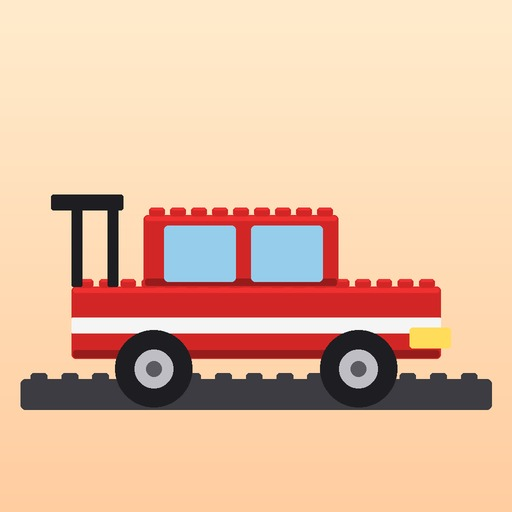<br>
      <sub><b>Ridgeback Rally Car</b><br>BW-001 · Vehicles</sub>
    </td>
    <td align="center" valign="top" width="25%">
      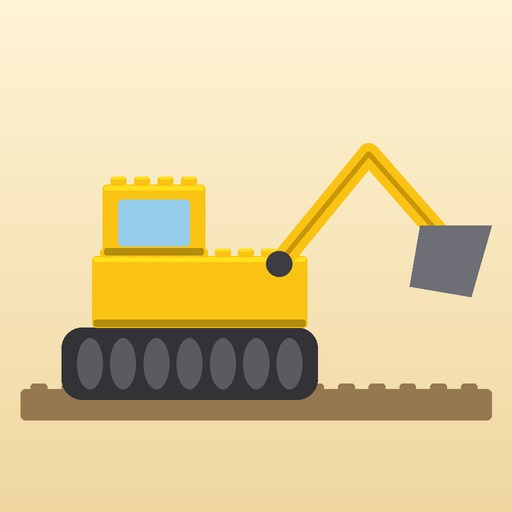<br>
      <sub><b>Titan Track Excavator</b><br>BW-002 · Construction</sub>
    </td>
    <td align="center" valign="top" width="25%">
      <br>
      <sub><b>Skyline Commuter Jet</b><br>BW-003 · Transport</sub>
    </td>
    <td align="center" valign="top" width="25%">
      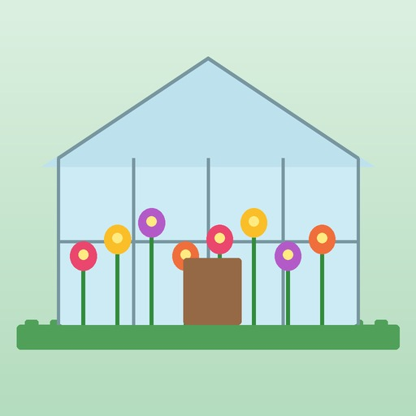<br>
      <sub><b>Glasshouse Garden</b><br>BW-004 · Nature</sub>
    </td>
  </tr>
</table>

<sub>All names, IDs and images above are fictional or original. No Rebrickable or LEGO data or images.</sub>
</details>

Tested with Python 3.12 (3.14 was not tried; PyTorch and FAISS wheels may lag) and Node 24.

**1. Install**

```bash
git clone https://github.com/chamodiHsenevirathna/brickwise && cd brickwise
python3.12 -m venv .venv
.venv/bin/pip install -r backend/requirements.txt
(cd frontend && npm install)
```

**2. Build the local catalogue (one time, needs internet, no API key)**

```bash
cd backend
../.venv/bin/python -m brickwise.data.ingest --limit 800     # ~800 sets, 18 themes, images -> data/
../.venv/bin/python -m brickwise.ml.embeddings               # downloads CLIP weights once; ~30 s on Apple GPU
```

**3. Run the main app** (your own profile, all 800 sets)

```bash
cd backend && ../.venv/bin/uvicorn brickwise.api.main:app --port 8000     # terminal 1
cd frontend && npm run dev                                                # terminal 2: http://localhost:5173
```

**4. Run the demo** (separate process, database, feedback and embeddings; never touches your profile)

```bash
cd backend && ../.venv/bin/python -m brickwise.data.demo_ingest          # one time: fictional demo DB + embeddings
cd backend && ../.venv/bin/uvicorn brickwise.api.demo:create_default_app --factory --port 8001
cd frontend && npm run dev:demo                                          # http://localhost:5174
```

The demo starts the real-catalogue demo if you have built it, otherwise the fictional one (`BRICKWISE_DEMO_CATALOGUE=real|fictional` overrides). The banner always says which. In the demo you can start **fresh**, or press **Load example profile (simulated)**; **Reset demo** clears only the demo database.

<details>
<summary>Build the real-catalogue demo (local, one time)</summary>

```bash
cd backend
../.venv/bin/python -m brickwise.data.demo_real propose   # picks 16 sets, writes data/demo-real/contact_sheet.png
# review the contact sheet; edit data/demo-real/selection.proposed.json to swap a set
../.venv/bin/python -m brickwise.data.demo_real freeze    # only after you have reviewed it
../.venv/bin/python -m brickwise.data.demo_real build     # demo DB + embeddings
```

- Your database is opened **read-only** with a SQLite authorizer that **denies any read of the `feedback` table**, so your own ratings cannot influence the selection or leak into the demo.
- The 16 product records are copied unchanged. The existing CLIP embeddings are sliced out of `data/embeddings.npy`; CLIP is not run again.
- Photographs are served from `data/images/` through a GET-only route restricted to the 16 selected files, and are not copied.
- Everything the builder writes lives in `data/demo-real/`, which is git-ignored.
</details>

**5. Test**

```bash
cd backend && ../.venv/bin/python -m pytest tests            # 95 tests: data, ML, API, demo (no network, CLIP or real catalogue needed)
cd frontend && npm run typecheck && npm test && npm run build && npm run build:demo
```

Set `BRICKWISE_DATA_DIR` to keep generated data somewhere other than `./data`. There are no API keys or secrets to configure, so there is no `.env` file.

<details>
<summary>Project structure</summary>

```
brickwise/
├── backend/
│   ├── brickwise/
│   │   ├── data/   ingest.py, products.py, demo_ingest.py, demo_real.py, demo_artwork.py
│   │   ├── ml/     embeddings.py, service.py, evaluation.py
│   │   └── api/    main.py (personal app), demo.py (demo app), db.py, recommender.py
│   └── tests/{data,ml,api,demo}/
├── frontend/       src/{api,components,hooks,pages,test}/
├── data/demo/      fictional catalogue: products, synthetic preferences, original images
├── docs/           CONTRACTS.md, INDEPENDENT_DEMO.md, assets/ (README images)
└── data/           generated, git-ignored: brickwise.db, images/, embeddings.npy, demo-real/
```
</details>

## Future direction

**Nothing in this section is implemented.** It describes how the design could grow.

- **Real-user evaluation:** people rating real sets, many users, and held-out *recommendation* feedback, ideally with an online A/B test against a non-personalised ordering.
- **Other catalogues:** the recommender only needs an image and an id per item. Fashion, furniture or collectibles would need their own ingestion and evaluation; whether general-purpose CLIP features suit each domain is untested.
- **Recommendation diversity**, so the top picks aren't near-duplicates.
- **Product metadata and text embeddings** combined with image embeddings; price and budget preferences.
- **Hybrid models** blending content-based scores with collaborative signals once there are many users.
- **A hosted demo** on the fictional catalogue, so the experience can be tried without setup.

## Data, licensing and attribution

**Set data and images** come from [Rebrickable](https://rebrickable.com): the public `sets` and `themes` CSV downloads, plus the set images hosted on Rebrickable's CDN. Please credit **Rebrickable.com**. This project has **not** verified Rebrickable's terms for the CSVs or for the images, and nothing here grants you any right to that data. Read Rebrickable's terms before using or sharing it.

- **Images in this repository.** `docs/assets/products/` and the screenshots in `docs/assets/screenshots/` and `docs/assets/hero.png` contain **16 real LEGO® set photographs** from the Rebrickable catalogue, shown to illustrate the product. They are owned by the LEGO Group and other rights holders. **Attribution is not permission to redistribute them**, and their redistribution terms have not been verified; they will be removed on request. The other 784 images, the dataset, the SQLite database (which holds your ratings) and the CLIP embeddings are **not** part of this repository: they live in `data/`, which is git-ignored.
- **Set names and numbers** shown in the README are catalogue metadata from Rebrickable; whether public display is permitted is an open question (see [NOTICE.md](NOTICE.md)).
- **The fictional demo** in `data/demo/` is separate: its products and artwork are fictional and original, and contain no Rebrickable or LEGO data or images.
- **Example profiles are simulated or synthetic.** They are not collected from any person, and are not evidence of recommendation quality.

**LEGO® disclaimer.** Brickwise is an independent project. It is not affiliated with, sponsored by or endorsed by the LEGO Group or Rebrickable. LEGO® is a trademark of the LEGO Group. The Brickwise name and logo mark are original and are not LEGO® trade dress.

## Licence

No licence has been selected yet, so by default all rights in the Brickwise source code are reserved by its author. When one is chosen, it will apply **only to the original source code and documentation in this repository**. It will not cover Rebrickable data, set images, LEGO® names or marks, or third-party libraries and model weights, which stay under their own terms (see [NOTICE.md](NOTICE.md)).
