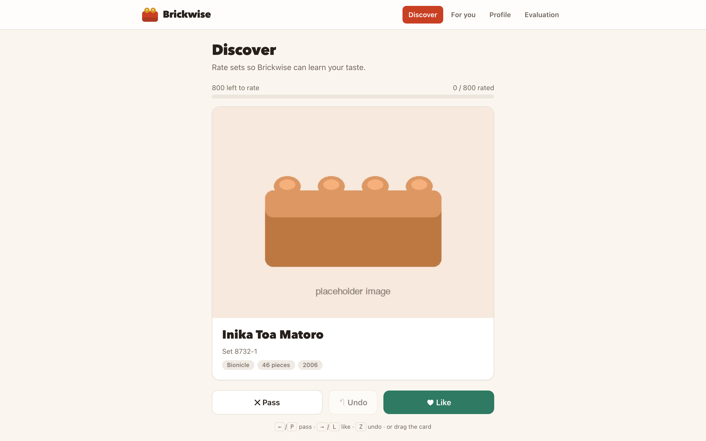
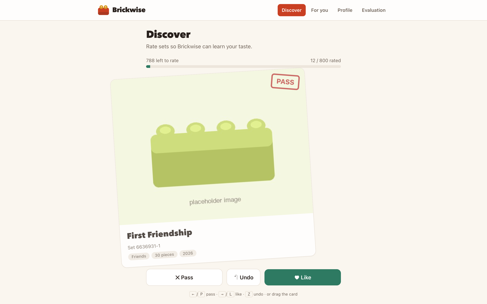
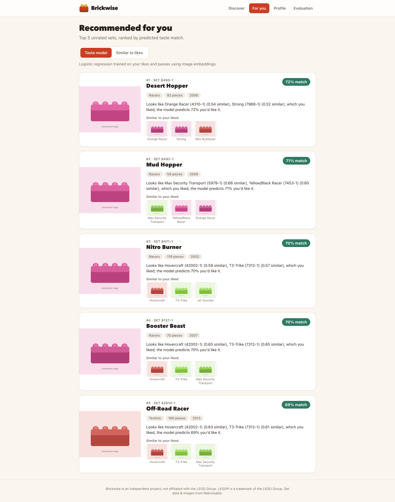
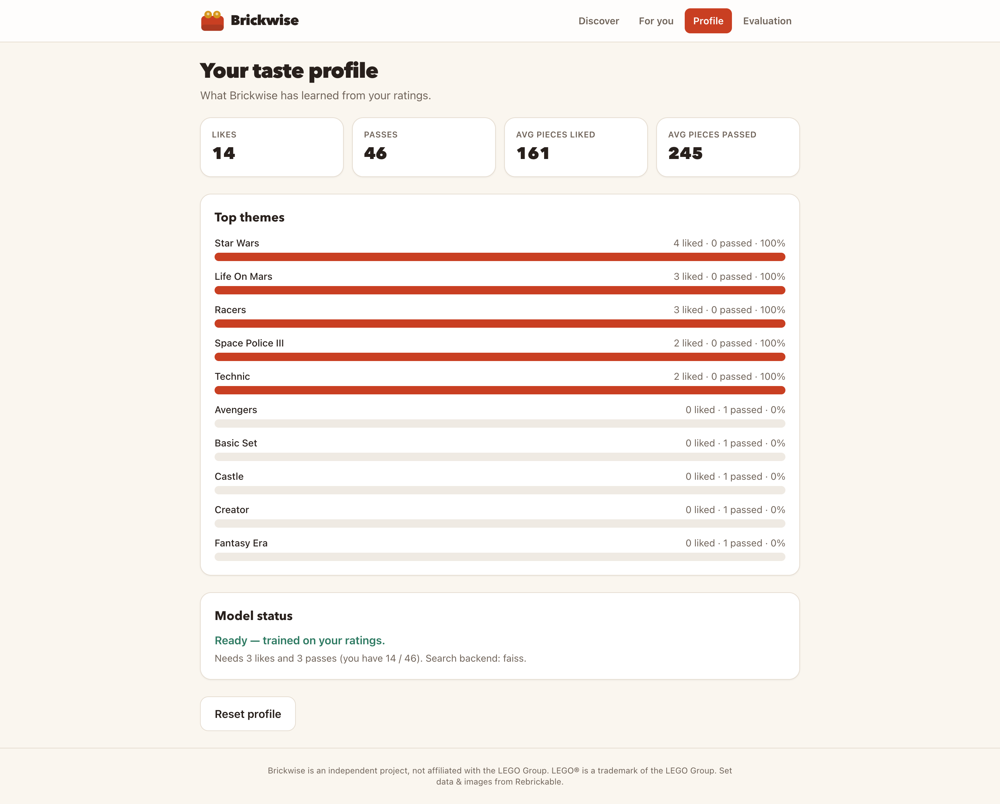
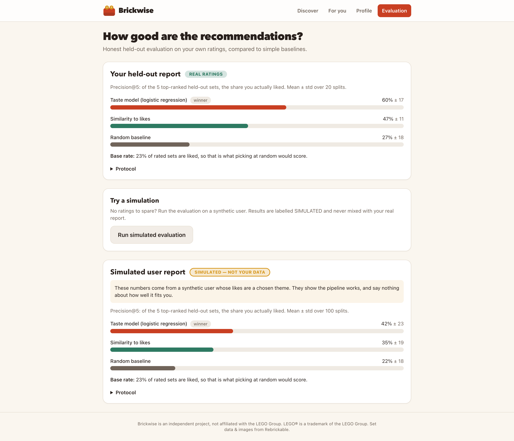
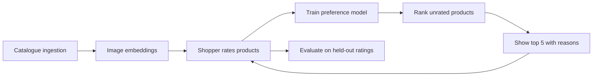
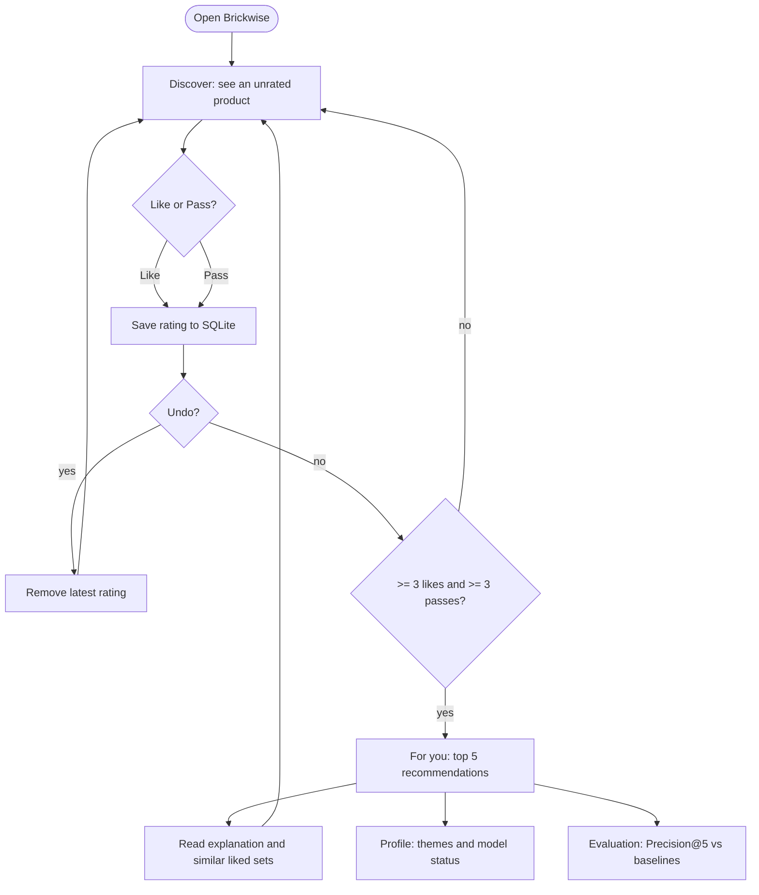
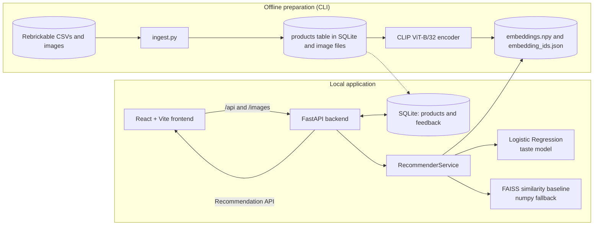
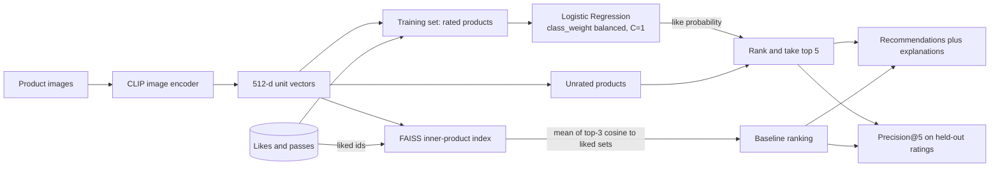

# Brickwise

**Discover products that match your preferences.**

Brickwise is an AI-powered visual product discovery and personalisation platform. Instead of asking people to search, filter and scroll, it learns their taste from a stream of quick Like / Pass decisions on product images, then ranks the rest of the catalogue by how well each item fits.

LEGO® sets are the demonstration catalogue. The recommendation architecture does not depend on LEGO, and the same approach could be pointed at other image-rich catalogues (see [Future direction](#future-direction)).




> Status: working local MVP. Runs entirely on your machine with free tools: no paid APIs, no accounts, no cloud. It has **not** been evaluated with real users yet; see [Evaluation](#evaluation-and-experimentation).

---

## The problem

Large catalogues have thousands of items, and most people want a handful. The usual tools help, but each has limits:

- **Browsing** does not scale. Nobody scrolls through 800 pages of results, let alone 80,000.
- **Categories and filters** need the shopper to already know what they want, in the catalogue's vocabulary. Taste is often visual and hard to put into words ("something like that, but less busy").
- **Keyword search** matches titles and descriptions, not how a product looks.
- **Generic recommendations** ("popular", "best sellers") serve the average shopper, not this one.

## The solution

Brickwise treats discovery as a feedback loop. Showing a product and asking "yes or no?" is faster and more honest than asking someone to describe their taste.

1. The shopper sees one product at a time and taps **Like** or **Pass** (or presses a key, or swipes).
2. Every product image has been converted into an embedding that captures its visual character.
3. After a few ratings, a classifier learns which visual features go with the shopper's likes and passes.
4. The classifier scores every unrated product, and the best five become the recommendations, each with a plain-English reason.

The model is retrained from scratch on each recommendation request, so new feedback is reflected immediately.

## Product experience

### Discovery

One large card per product, with the name, set number, theme, piece count and year. Like and Pass buttons, Undo, keyboard shortcuts (`→`/`L` like, `←`/`P` pass, `Z` undo), and a progress bar. Ratings are saved instantly and survive restarts.



*Mid-swipe: dragging the card reveals a PASS (or LIKE) stamp before the rating is committed.*

### Personalised recommendations

The top five unrated products, ranked by predicted match. Each card explains itself using the liked sets it most resembles, and a toggle switches between the learned taste model and the plain similarity baseline.



*Recommendations after 60 ratings from a scripted demo profile whose taste is vehicles and space (placeholder images shown instead of set photos). The percentages are the classifier's predicted like-probability; the "similar to your liked" entries come from real nearest-neighbour lookups.*

### Preference profile

A readable summary of what the system has learned: counts, average piece count of liked versus passed sets, per-theme like rates and the model's status.



*The same demo profile. The system also shows when it is not ready (fewer than 3 likes or 3 passes).*

### Evaluation dashboard

Precision@5 for the taste model, the similarity baseline and a random baseline. Results computed from the user's own ratings and results from synthetic users are shown in separate, clearly badged panels.



*Top panel: held-out evaluation of the scripted demo profile's 60 ratings (a script, not a customer). Bottom panel: a simulated-user run, labelled "Simulated, not your data".*

> **About these screenshots.** They come from the real running application, captured with Playwright against a scratch copy of the data. The product photographs have been replaced with generic placeholder bricks drawn for this project, because the real set photos belong to third parties and are not redistributed here. Set names, numbers, themes, piece counts and the recommendations themselves are real: the ranking was computed from the CLIP embeddings of the actual photos. The demo profile was rated by a script following a stated taste, so the numbers show the pipeline working, not how well Brickwise suits real people. When you run the app locally with the ingested dataset, you see the real photos.

## How it works



1. **Catalogue ingestion.** `brickwise.data.ingest` downloads the public Rebrickable `sets` and `themes` CSVs, cleans them (drops rows with missing names, images or too few parts, and non-set themes), keeps about 800 sets from the 18 largest root themes (about 44 each), downloads and verifies each image, and writes everything to SQLite and `data/images/`. No API key is needed.
2. **Image embeddings.** `brickwise.ml.embeddings` encodes each image with CLIP (ViT-B/32, open_clip) into a 512-dimensional L2-normalised vector and caches them in `data/embeddings.npy`. Only missing items are embedded on a re-run, and cache rows for removed products are pruned.
3. **Preference collection.** The API stores each rating in SQLite (`1` = like, `0` = pass). One row per product enforces no duplicates; Undo removes the most recent rating.
4. **Model training.** With at least 3 likes and 3 passes, a logistic regression is fitted on the rated products' embeddings. Below that threshold the API answers `insufficient_feedback` instead of guessing.
5. **Recommendation ranking.** Every unrated product is scored; already-rated products are never returned. The top five are returned with their like-probability and the three most similar liked sets.
6. **Evaluation.** Precision@5 is measured on held-out ratings and compared against the similarity baseline and random.

### End-to-end user journey



## System architecture



The backend owns ratings. The ML package never touches the database: the API hands it a `{set_num: rating}` map, and it returns ranked ids that the API turns into full products. The API contract is documented in [docs/CONTRACTS.md](docs/CONTRACTS.md).

## Machine learning approach



**CLIP** turns each product image into a vector. Images that look alike land close together, so "visually similar" becomes a distance. It is a general-purpose model, used here without fine-tuning.

**Logistic regression** is trained on the user's own likes and passes, with the CLIP vectors as features. It outputs a probability that the user would like an unseen product. It is small, fast, needs few examples, and retrains in milliseconds. Classes are weighted, because most people pass on most things.

**FAISS** provides the baseline. It indexes all embeddings (`IndexFlatIP`, which is cosine similarity on unit vectors) and scores each unrated product by its mean similarity to its three nearest liked sets. If FAISS cannot be imported, a numpy cosine implementation is used (both are tested for parity).

**Precision@5** asks: of the five highest-ranked items, how many did the user actually like? Higher is better, and the random baseline equals the share of products the user likes.

**Why compare both approaches?** The similarity baseline uses only what the shopper liked. The classifier also uses what they passed on, so it can learn that a visual trait is a reason to *reject* something. Whether that extra signal is worth having is an empirical question, so the app measures both on the same held-out data.

## Evaluation and experimentation

**Real evaluation** (`GET /api/evaluation`) uses the user's own ratings. It needs at least 10 ratings with at least 4 likes and 4 passes; otherwise it reports `sufficient: false` and says why. The protocol is 20 repeated stratified 70/30 hold-outs. In each split, the models train on 70% of the ratings, rank the held-out 30%, and Precision@5 is the share of liked items in the top five (or in the top `n_test` when fewer than five items are held out, in which case it collapses to the base rate).

**Simulated evaluation** (`POST /api/evaluation/simulate`) runs the same procedure on synthetic users. Each synthetic user likes every product in 1–3 random root themes (more are added until at least 15% of products are liked), with 10% label noise, and rates a random 120 products. The report always carries `simulated: true`, and the UI badges it.

### Synthetic results (simulated, not real users)

Run on the 800-set catalogue with the real CLIP embeddings: 5 synthetic users × 20 splits, mean Precision@5 (std across splits in brackets).

| Seed | Taste model (logreg) | Similarity (FAISS) | Random | Base rate |
|---|---|---|---|---|
| 0 | 0.42 (0.23) | 0.35 (0.19) | 0.22 (0.18) | 0.23 |
| 1 | 0.50 (0.18) | 0.40 (0.20) | 0.21 (0.15) | 0.22 |
| 2 | 0.42 (0.23) | 0.39 (0.19) | 0.23 (0.20) | 0.24 |

These numbers say the pipeline learns something beyond chance on a synthetic task. They do **not** say how well it serves a real shopper. The synthetic "taste" is a product theme, which is only a loose proxy for what CLIP sees, and the variance across splits is large.

### What real-user evaluation needs

- Real people rating real sets (not a script), with at least 10 ratings each; more is better.
- Many users, so the comparison is not driven by one person's taste.
- Held-out *recommendation* feedback (did people like what was actually recommended?), not just held-out ratings.
- Ideally an online A/B comparison against a non-personalised ordering.

None of this has been done. The app computes the real-user report as soon as it has the data.

### Current limitations

- No real-user results yet; the synthetic results above are the only quantified evidence beyond unit tests.
- The catalogue is 800 sets from 18 themes, not the full LEGO range.
- One local profile; no authentication or multi-user support.
- CLIP is general-purpose and its model card describes it as a research output (deployed use is out of its stated scope; see `NOTICE.md`). It captures overall look (colour, shape, vehicle versus figure), not build complexity or minifigure content.
- The model retrains on every recommendation request. This is instant at 800 items and would need caching at scale.
- The UI has been checked in desktop Chrome screenshots and jsdom tests only. Mobile layout and dark mode were not manually verified.
- The first embedding run needs internet access to download the CLIP weights.

## Technology stack

| Layer | Technology |
|---|---|
| Frontend | React 18, TypeScript 5.6, Vite 5, Tailwind CSS 3, react-router |
| Backend | Python 3.12, FastAPI, Pydantic, SQLite (stdlib `sqlite3`), Uvicorn |
| Data | Rebrickable public CSV dataset and CDN images, Pillow |
| ML | open_clip (CLIP ViT-B/32), PyTorch, scikit-learn LogisticRegression, FAISS (CPU), NumPy |
| Testing | pytest + FastAPI TestClient, Vitest + Testing Library + jsdom, `tsc --noEmit` |

## Getting started

Tested with Python 3.12 (3.14 was not tried; PyTorch and FAISS wheels may lag) and Node 24.

**1. Install**

```bash
cd brickwise
python3.12 -m venv .venv
.venv/bin/pip install -r backend/requirements.txt
(cd frontend && npm install)
```

**2. Build the data (one time, needs internet, no API key)**

```bash
cd backend
../.venv/bin/python -m brickwise.data.ingest --limit 800     # ~800 sets, 18 themes, images -> data/
../.venv/bin/python -m brickwise.ml.embeddings               # downloads CLIP weights once; ~30 s on Apple GPU
```

Add `--offline-sample` to `ingest` to create a tiny synthetic dataset when offline (for tests only).

**3. Run**

```bash
# terminal 1
cd backend && ../.venv/bin/uvicorn brickwise.api.main:app --port 8000
# terminal 2
cd frontend && npm run dev          # open http://localhost:5173
```

Optional: set `BRICKWISE_DATA_DIR` to keep the generated data (database, images, embeddings) somewhere other than `./data`. There are no API keys or other secrets to configure, so there is no `.env` file.

**4. Test**

```bash
cd backend && ../.venv/bin/python -m pytest tests          # 64 tests: data, ML, API (no network or CLIP needed)
cd frontend && npm run typecheck && npm test && npm run build
```

## Project structure

```
brickwise/
├── backend/
│   ├── brickwise/
│   │   ├── data/          ingest.py, products.py       catalogue ingestion and loading
│   │   ├── ml/            embeddings.py, service.py,   CLIP cache, recommender, evaluation
│   │   │                  evaluation.py
│   │   ├── api/           main.py, db.py,              FastAPI app, SQLite helpers,
│   │   │                  recommender.py               lazy recommender adapter
│   │   ├── paths.py       schema.sql
│   ├── tests/{data,ml,api}/
│   └── requirements.txt
├── frontend/
│   └── src/{api,components,hooks,pages,test}/          Discover, Recommendations, Profile, Evaluation
├── docs/
│   ├── CONTRACTS.md       API and ML contracts
│   └── assets/            README screenshots
└── data/                  generated, git-ignored: brickwise.db, images/, embeddings.npy
```

## Future direction

Nothing in this section is implemented. It describes how the current design could grow.

**Other catalogues.** The recommender only needs an image per item and an item id. A catalogue of fashion, furniture, electronics, books or collectibles would need its own ingestion step and, to be worthwhile, an evaluation with real shoppers. Whether general-purpose CLIP features work well for each domain is untested.

Possible extensions:

- **Multiple product categories** in one catalogue, with category-aware ranking.
- **Price and budget preferences** as constraints or features.
- **Product metadata and text embeddings** (titles, descriptions) combined with image embeddings.
- **Hybrid recommendation models** that blend content-based scores with collaborative signals once there are many users.
- **User segmentation** to give new shoppers a better starting point than random order.
- **Recommendation diversity**, so the top five are not five near-duplicates (visible in the demo, where several results are similar buggies).
- **A/B testing** of ranking strategies against real shoppers.

## Data, licensing and attribution

**Set data and images** come from [Rebrickable](https://rebrickable.com): the public `sets` and `themes` CSV downloads, plus the set images hosted on Rebrickable's CDN. Please credit **Rebrickable.com**. This project has **not** verified Rebrickable's terms for the CSVs or for the images, and nothing here grants you any right to that data. Read Rebrickable's terms before using or sharing it.

- The dataset, downloaded images, SQLite database (which holds your ratings) and CLIP embeddings are **not** part of this repository. They live in `data/`, which is git-ignored, and are created on your machine by the commands above.
- The set photographs are owned by their respective rights holders. Attribution is not permission to redistribute them, so they are not republished here and the README screenshots use placeholders.
- Set names and numbers shown in the screenshots are factual catalogue metadata from Rebrickable; whether showing them in a public repository is acceptable is an open question (see `NOTICE.md`).

**LEGO® disclaimer.** Brickwise is an independent project. It is not affiliated with, sponsored by or endorsed by the LEGO Group. LEGO® is a trademark of the LEGO Group. The Brickwise name and logo mark are original and are not LEGO® trade dress.

## Licence

No licence has been selected yet, so by default all rights in the Brickwise source code are reserved by its author. When one is chosen, it will apply **only to the original source code and documentation in this repository**. It will not cover Rebrickable data, set images, LEGO® names or marks, or third-party libraries and model weights, which stay under their own terms (see [NOTICE.md](NOTICE.md)).
